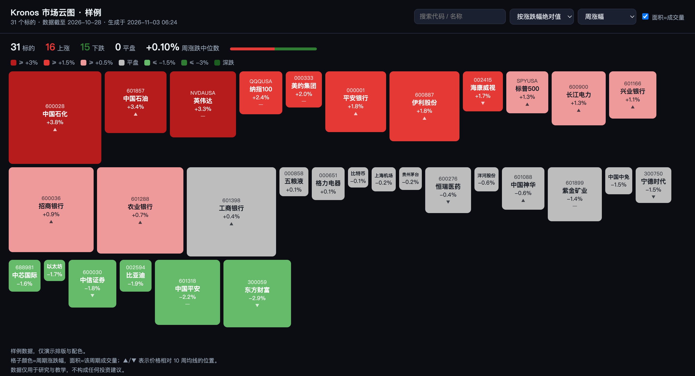

# Kronos Workbench

> 把 K 线数据、市场云图和模型评测串成一条能复现的流水线。

[](https://github.com/timsurg-boop/kronos-cn/actions/workflows/ci.yml)
[](https://www.python.org/)
[](LICENSE)



这是一个围绕 [Kronos](https://github.com/shiyu-coder/Kronos) K 线基础模型搭的工作台，解决三件具体的事：

1. **数据进得来**：A 股 / 美股行情抓取、字段归一、质量体检，输出统一的 `date,open,high,low,close,volume,amount`。
2. **结果看得懂**：一张 HTML 市场云图，颜色是周/月/季/年涨跌幅，面积是成交量，点开直达行情页。
3. **模型评得准**：滚动窗口 RankIC + TopN 多空组合，先有基线，再谈调参。

它不预测明天涨跌，也不打包模型权重。预测能力来自 Kronos，这个仓库负责让数据和评测变得干净、可复现。

## 特性

- **一条命令出云图**：`kronos-cn demo` 用自带样例数据直接生成，不联网、不需要 token。
- **颜色口径可选**：默认 A 股习惯「红涨绿跌」，`--scheme intl` 切换为「绿涨红跌」。
- **数据体检**：缺列、重复日期、断档、OHLC 异常、零成交量一次查完。
- **可复现评测**：固定交易日历与随机种子，输出逐期 CSV、净值曲线和汇总指标。
- **无隐藏路径**：全部目录来自环境变量，clone 到哪台机器都能跑。
- **轻量依赖**：基础安装只要 pandas / numpy / matplotlib，抓取和预测都是可选 extras。

## 快速开始

```bash
git clone https://github.com/timsurg-boop/kronos-cn.git
cd kronos-cn
python -m venv .venv && source .venv/bin/activate
pip install -e ".[dev]"

# 用自带样例数据生成云图（31 个标的，不联网）
kronos-cn demo --open
```

输出 `heatmap.html`，浏览器直接打开即可。

### 接入自己的数据

```bash
export TUSHARE_TOKEN=...          # 仅 Tushare 兜底时需要
kronos-cn fetch 600519            # 默认存到 ~/.kronos/data/600519_kronos.csv
kronos-cn validate                # 体检
kronos-cn heatmap --open          # 出图
```

目录默认值：

| 变量 | 默认 | 用途 |
|------|------|------|
| `KRONOS_HOME` | `~/.kronos` | 所有本地状态的根目录 |
| `KRONOS_DATA_DIR` | `$KRONOS_HOME/data` | 归一后的 `*_kronos.csv` |
| `KRONOS_RAW_DIR` | `$KRONOS_HOME/raw` | 抓取原始文件 |
| `KRONOS_OUTPUT_DIR` | `$KRONOS_HOME/output` | 云图、预测、评测结果 |
| `KRONOS_MODEL_DIR` | `$KRONOS_HOME/models` | Kronos 权重 |
| `TUSHARE_TOKEN` | 空 | Tushare Pro token |

## 命令

| 命令 | 作用 |
|------|------|
| `kronos-cn demo` | 用 `examples/data` 生成样例云图 |
| `kronos-cn validate` | 数据质量体检 |
| `kronos-cn heatmap` | 生成市场云图（`--metric wk/mo/qtd/ytd`，`--scheme cn/intl`） |
| `kronos-cn chart CODE` | 生成日/周/月 K 线三联图（`--period D W M`，默认自动打开） |
| `kronos-cn dividend` | 用红利表生成红利热力图 |
| `kronos-cn fetch CODE` | 抓取单只标的（Akshare 优先，Tushare 兜底） |
| `kronos-cn predict CODE --plot` | 调用 Kronos 预测并画图（需要权重） |
| `kronos-cn eval` | 滚动 RankIC 评测 |
| `kronos-cn names --refresh` | 从 Akshare 重建本地代码名称表 |

完整参数见 `kronos-cn <command> --help`。

## 数据格式

只认一种格式，没有隐藏列：

```csv
date,open,high,low,close,volume,amount
2024-01-02,1680.0,1695.0,1672.0,1688.0,31200,52600000
```

约定：

1. `date` 为 ISO 日期，严格递增、无重复。
2. 价格为**前复权**，成交量与成交额同源。
3. A 股代码为 6 位数字；美股用 `AAPLUSA`；加密用 `BTCUSA`。
4. 周末数据只应出现在加密标的，`validate` 会单独标注。

明细见 [docs/data-format.md](docs/data-format.md)。

### K 线三联图

```bash
kronos-cn chart 600519 --period D W M
```

一张 PNG 里纵向排三组：日K、周K、月K。每组上方是蜡烛图与 MA5/MA10/MA20，下方是成交量；默认显示 180 / 120 / 60 根，可用 `--bars` 覆盖。红涨绿跌，数据直接来自本地 CSV，不联网。

默认从 `$KRONOS_DATA_DIR` 读数据、写到 `$KRONOS_OUTPUT_DIR/charts/`，也可以临时指定：

```bash
kronos-cn chart 600519 --period D W M --data-dir ~/Desktop/Kronos --out /tmp/600519.png
```

## 预测与评测

预测和评测需要上游 Kronos 的模型代码与权重，本仓库不附带：

```bash
git clone https://github.com/shiyu-coder/Kronos.git ~/Kronos-upstream
export KRONOS_UPSTREAM=~/Kronos-upstream
pip install -e ".[predict]"
# 权重放到 $KRONOS_MODEL_DIR/Kronos-mini 与 Kronos-Tokenizer-2k，或直接走 Hugging Face
kronos-cn predict 600519 --plot --open
```

评测走滚动窗口：每隔 `--step` 个交易日调仓，用当日及之前 512 根日线预测未来 `--pred` 日收益，计算截面 Spearman RankIC，并统计 TopN / BottomN 组合。

```bash
kronos-cn eval --symbols 50 --pred 20 --step 20 --samples 3
```

输出 `$KRONOS_OUTPUT_DIR/eval_20d_step20.csv` 与净值曲线 PNG。方法与指标解释见 [docs/evaluation.md](docs/evaluation.md)。

## 项目结构

```text
kronos-cn/
├── src/kronos_cn/
│   ├── cli.py              # 命令行入口
│   ├── config.py           # 环境变量与路径解析
│   ├── names.py            # 代码 → 名称（内置 5600+ 条）
│   ├── data/               # 抓取、归一、聚合、体检
│   ├── heatmap/            # 市场云图、红利热力图、配色
│   ├── evaluation/         # 纯指标 + 回测执行器
│   ├── kline.py            # 日/周/月 K 线三联图
│   ├── predict.py          # Kronos 推理封装
│   └── plot.py             # 预测图
├── examples/data/          # 31 个标的的脱敏样例
├── docs/                   # 架构、数据格式、评测说明
└── tests/                  # 28 个单元测试，CI 跑 3 个 Python 版本
```

## 设计取舍

**为什么把指标计算和渲染分开？** 云图的数学（周期涨幅、成交量聚合）藏在 `Snapshot` 里，渲染只负责 HTML。这样指标可以单测，换配色或布局不会碰数值。

**为什么默认红涨绿跌？** 面向 A 股用户，颜色应该符合肌肉记忆。阈值表在 `heatmap/theme.py` 里，`BUCKETS` 和 `SCHEMES` 都是纯数据，改一行就能换口径。

**为什么不用 Jinja？** 一张页面、四个网格，`html.escape` 加 f-string 足够，少一个依赖。

**为什么样例数据只有 780 根 K 线？** 够覆盖周/月/季/年四个周期，又把仓库控制在 1.5MB 以内。真实使用请用 `fetch` 拉全量。

## 路线图

- [ ] 云图导出 PNG / PDF，方便丢进周报
- [ ] 板块与指数聚合视图
- [ ] 评测支持手续费、滑点与涨跌停约束
- [ ] 数据源插件化（AkShare / Tushare / 本地 Parquet）
- [ ] GitHub Actions 定时刷新样例数据

## 数据与免责声明

仓库内 `examples/data` 为裁剪后的历史行情，仅用于演示排版与测试，不构成任何投资建议。实盘数据请自行通过合规渠道获取，并遵守各数据源的服务条款。

## 贡献

见 [CONTRIBUTING.md](CONTRIBUTING.md)。安全问题请走 [SECURITY.md](SECURITY.md) 的私下渠道。

## 许可

本项目以 MIT 许可发布。上游 [Kronos](https://github.com/shiyu-coder/Kronos) 同为 MIT，版权归 ShiYu 所有，详见 [NOTICE](NOTICE)。
